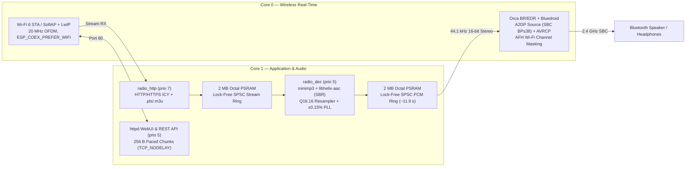

# ESP32-S31-Zero Classic Bluetooth Internet Radio

Standalone **Wi-Fi 6 → Classic Bluetooth (A2DP Source + AVRCP) Internet Radio** for the **[Waveshare ESP32-S31-Zero](https://www.waveshare.com/esp32-s31-zero.htm)** — requiring **zero external hardware** (just the board and a USB-C cable).

Built natively on **ESP-IDF v6.1** (`esp32s31` dual-core 320 MHz RISC-V) via **PlatformIO** (`pioarduino/platform-espressif32`), combining the ESP32-S31 **Orca BR/EDR Classic Bluetooth Controller**, Bluedroid **A2DP Source + AVRCP**, **200 MHz Octal PSRAM** lock-free ring buffers (`2 MB` stream + `2 MB` PCM), pure-C **MP3 (`minimp3`)** and **AAC / HE-AAC SBR (`libhelix-aac`)** decoders, a single-page **Desktop Browser WebUI**, onboard **WS2812B RGB LED + BOOT button** controls, **internal chip temperature monitoring**, and a **USB-C Serial/JTAG CLI**.

> **Tested reliability:** Verified in continuous **45+ hour** soak testing (`0` reboots, zero SRAM/PSRAM leaks, stable `52–64 °C` die temperature) and tuned specifically for ESP32-S31 single-antenna 2.4 GHz Wi-Fi + Classic Bluetooth A2DP coexistence.

---

## Architecture Overview



For deep engineering notes on dual-core pinning, SRAM vs. Octal PSRAM budgeting, single-antenna 2.4 GHz coexistence tuning, and empirical measurements, see **[docs/ARCHITECTURE.md](docs/ARCHITECTURE.md)**.

---

## Features

- **Classic Bluetooth A2DP Source + AVRCP (`CT` & `TG`)**
  - Streams decoded radio audio wirelessly at **44.1 kHz, 16-bit Joint Stereo SBC** (max bitpool capped at `38` ≈ 245 kbps for clean 2.4 GHz coexistence) to any Classic Bluetooth speaker or headphones.
  - Built-in Bluetooth inquiry scanner (`Scan Speakers` in WebUI or `bt scan` in CLI) with Remote Name Resolution (`EIR` + `RNR`), audio sink Class-of-Device filtering, RSSI, Secure Simple Pairing (`SSP`), legacy PIN fallback, and automatic reconnect on boot with 30 s backoff.
  - Two-way **AVRCP absolute volume** sync plus speaker/headphone media button support (**Play / Pause / Next / Previous**).
  - Automatic **Bluetooth AFH channel masking** (`esp_bt_gap_set_afh_channels`) that blacklists the active 22 MHz Wi-Fi STA channel band to minimize self-interference.
- **MP3 + AAC / HE-AAC (SBR) HTTP & HTTPS Streaming**
  - Connects to Icecast / Shoutcast HTTP and HTTPS streams (full ESP-IDF X.509 CRT bundle), follows redirects, and resolves `.pls` and `.m3u` playlists automatically.
  - Extracts inline **ICY Metadata** (`StreamTitle`) for live track titles in the WebUI and CLI.
  - **2 MB** compressed stream buffer + **2 MB (~11.9 s)** decoded PCM buffer in **200 MHz Octal PSRAM** using lock-free C11 atomic SPSC rings, fast `64 KB` (~360 ms) initial prime, `352 KB` (~2.0 s) clean post-underrun rebuffer, and a **±0.15% micro-PLL** fractional stereo resampler (`22.05 / 24 / 32 / 44.1 / 48 kHz` → `44.1 kHz`) to absorb server/Bluetooth clock drift.
  - 20 s stall auto-reconnect watchdog in the supervisor task.
- **27 Worldwide Low-Bitrate (`35–96 kbps`) Jazz Presets**
  - Curated across 13 countries and 5 continents (all plain-HTTP, verified live ADTS AAC / HE-AAC or 56k MP3) to stay comfortably inside the ESP32-S31 single-antenna Wi-Fi + BT throughput envelope (`32` total NVS preset slots with 5 open for custom stations).
- **Desktop Browser WebUI + Provisioning**
  - Configure Wi-Fi via the **USB-C CLI** (`wifi set <ssid> <pass>`) or automatic fallback SoftAP (`ESP32-S31-Radio` → `http://192.168.4.1/`).
  - Manage playback from `http://<board-ip>/` or `http://esp32s31-radio.local/`: live stereo VU meters, compressed & PCM buffer health, chip temperature, searchable station manager, custom stream URL bar, Bluetooth scanner/pairing, and Wi-Fi switcher.
  - Paced `256`-byte chunked responses (`TCP_NODELAY`) keep the WebUI responsive during active Bluetooth A2DP streaming.
- **Onboard Zero-Hardware Controls & Telemetry**
  - **BOOT Button (`GPIO61`)**: Single click = Play/Pause · Double click = Next station · Hold 2.5 s = Scan & auto-pair nearest BT speaker.
  - **WS2812B-1010 RGB LED (`GPIO60`)**: Real-time visual state indicator (see table below).
  - **Internal Chip Temperature Sensor (`esp_driver_tsens`)**: Sampled every 2 s (`20–100 °C` range, warning logged at `≥ 80 °C`), exposed in `/api/status`, WebUI, and CLI `status`.

---

## Hardware & Pinout

Target board: **Waveshare ESP32-S31-Zero**

| Subsystem | Specification / Pin |
|---|---|
| SoC | ESP32-S31 Dual-Core 320 MHz RISC-V (Wi-Fi 6 + Classic BT BR/EDR) |
| Flash | 16 MB QSPI (`DIO`, `80 MHz`) |
| PSRAM | 16 MB / 32 MB Octal PSRAM (`200 MHz`) |
| Onboard RGB LED | WS2812B-1010 on `GPIO60` (RMT driver) |
| Onboard Button | BOOT button on `GPIO61` (active low) |
| USB Console / Flashing | Native USB-C Serial/JTAG on `GPIO33` / `GPIO34` |
| Thermal Monitor | Internal ESP32-S31 `tsens` (`20–100 °C`) |

### RGB LED Status Codes (`GPIO60`)

Driven in priority order by [`main/main.c`](main/main.c) and [`main/board_hw.c`](main/board_hw.c) (brightness capped at `≤ 28 / 255` for comfortable desk viewing):

| Priority | Color | Pattern / Timing | RGB *(0–255)* | Meaning |
|---:|---|---|---|---|
| 1 | 🔵 **Blue** | Fast blink (~120 ms) | `(0, 0, 28)` ↔ `(0, 0, 3)` | Scanning / pairing Classic Bluetooth speakers |
| 2 | 🟠 **Amber** | Slow breathing (~2.4 s) | `(4..24, 1..8, 0)` | Waiting for Wi-Fi / SoftAP setup (`ESP32-S31-Radio`) *(initial boot state)* |
| 3 | 🔴 **Red** | Blinking (~160 ms) | `(26, 0, 0)` ↔ `(0, 0, 0)` | Stream, HTTP/TLS, or network error |
| 4 | 🟣 **Purple** | Slow breathing (~2.4 s) | `(2..12, 0, 4..24)` | Connecting to station URL or pre-buffering audio |
| 5 | 🟢 **Emerald Green** | Solid | `(0, 20, 4)` | Actively streaming radio audio over Bluetooth A2DP |
| 6 | 🩵 **Soft Cyan** | Solid | `(0, 10, 14)` | Wi-Fi connected & ready (paused, stopped, or waiting for BT speaker) |

---

## Build & Flash

### Prerequisites

- **[PlatformIO Core](https://platformio.org/)** (`pio` CLI, `>= 6.1.0`)
- Linux / macOS / Windows with USB-C data cable connected to the ESP32-S31-Zero
- *(Linux)* User in the `dialout` group (`sudo usermod -aG dialout $USER`) for `/dev/ttyACM*` access

`make build` automatically runs [`tools/setup_pio_idf61.sh`](tools/setup_pio_idf61.sh) on first build to install the **pioarduino ESP-IDF v6.1** platform (`pioarduino/platform-espressif32#61.04.00-RC1`) into `~/.platformio/platforms/espressif32-idf61` (patched for standard PlatformIO Core `6.1.x` compatibility), while [`tools/pio_factory_offset.py`](tools/pio_factory_offset.py) ensures the `0x20000` `factory` partition offset from [`partitions.csv`](partitions.csv) is honored.

### Using `Makefile` (Recommended)

```bash
# 1. Build firmware (bootloader + partition table + app)
make build

# 2. Flash over USB-C (auto-detects highest /dev/ttyACM* or override with PORT=/dev/ttyACM1)
make flash

# 3. Open USB-C serial console (rts=0, dtr=0)
make monitor

# Or do build + flash + monitor in one step
make all
```

### Reliable Download-Mode Flashing (`make flash-dl`)

ESP32-S31's native USB-Serial/JTAG controller can occasionally drop mid-upload if software auto-reset fires while Wi-Fi/BT is active. The most reliable flashing sequence is:

1. Close any open serial monitor.
2. **Hold `BOOT`**, tap **`RESET`**, then release **`BOOT`** (enters ROM download mode).
3. Flash without software reset or RAM stub:
   ```bash
   make flash-dl
   # or specify port explicitly:
   make flash-dl PORT=/dev/ttyACM1
   ```
4. Tap **`RESET`** to boot the new firmware.

> **Important USB-Serial/JTAG note:** Always open the console with `rts=0, dtr=0` (configured automatically in `platformio.ini` and `make monitor`). Tools like `pyserial` that toggle DTR/RTS on open will reset the ESP32-S31 into download mode (`boot:0x4f`).

### Alternative: Standalone ESP-IDF v6.1

If you have standalone ESP-IDF v6.1 installed instead of PlatformIO:

```bash
export IDF_PATH=/path/to/esp-idf-v6.1
./build_and_flash.sh all /dev/ttyACM0
```

---

## First-Time Setup

### 1. Connect to Wi-Fi

**Option A — USB-C CLI (`make monitor`):**
```text
s31-radio> wifi scan
s31-radio> wifi set MyHomeWiFi MySecretPassword
s31-radio> status
```
`status` displays the board's IPv4 address:
```text
Desktop WebUI URL: http://192.168.1.xxx/  (or http://esp32s31-radio.local/)
```

**Option B — SoftAP Fallback (No USB terminal needed):**
When unconfigured (or unreachable), the board opens Wi-Fi AP **`ESP32-S31-Radio`**. Connect to it and visit `http://192.168.4.1/` to select your home network.

### 2. Pair a Bluetooth Speaker / Headphones

- **WebUI:** Open `http://esp32s31-radio.local/`, put your speaker in pairing mode, click **Scan Speakers**, then click **Connect**.
- **USB-C CLI:**
  ```text
  s31-radio> bt scan 10
  s31-radio> bt devices
  s31-radio> bt connect 0
  s31-radio> play 0
  s31-radio> vol 75
  ```
- **Onboard Button:** Hold **BOOT (`GPIO61`)** for 2.5 s to scan and auto-pair the nearest audio sink.

---

## Built-In Worldwide Low-Bitrate Jazz Presets (27 / 32 slots)

All default stations in [`main/radio_config.c`](main/radio_config.c) are plain-HTTP `35–96 kbps` (mostly `56–64 kbps`) AAC / HE-AAC streams plus 56k MP3 BBC World Service, chosen to deliver crisp stereo audio with zero underruns and responsive WebUI latency on ESP32-S31's single 2.4 GHz radio. Up to **32 presets** are stored in NVS (`cfg_v5`), leaving 5 free slots for custom stations (or edit/replace any preset via the WebUI or CLI).

| # | Station | Region | Format |
|---:|---|---|---|
| 0 | **KCSM Jazz 91.1 FM** (San Francisco) | US | 64k AAC |
| 1 | **WBGO 88.3 FM - Public Jazz** (Newark) | US | 64k AAC+ |
| 2 | **Jazz24 - KNKX 88.5 FM** (Seattle) | US | 64k AAC+ |
| 3 | **KUVO Jazz 89.3 FM** (Denver) | US | 65k AAC+ |
| 4 | **WZUM 88.1 FM - Pittsburgh Jazz** | US | 64k AAC+ |
| 5 | **WDCB 90.9 FM** (Chicago) | US | 96k AAC |
| 6 | **The Jazz Groove - West** | US | 64k AAC |
| 7 | **SmoothJazz.com Global** | US | 64k AAC+ |
| 8 | **Radio Swiss Jazz** | Switzerland | 88k AAC |
| 9 | **Jazz Radio - Classic Jazz** | France | 64k AAC+ |
| 10 | **Jazz Radio - Lounge** | France | 64k AAC+ |
| 11 | **NRK Jazz** | Norway | 63k AAC+ |
| 12 | **Jazz London Radio** | UK | 64k AAC+ |
| 13 | **RMC Jazz - Monte Carlo** | Italy | 96k AAC |
| 14 | **0N Jazz** | Germany | 64k AAC+ |
| 15 | **Klassik Radio - Dinner Jazz** | Germany | 64k AAC+ |
| 16 | **Sublime Soul & Jazz** | Netherlands | 96k AAC+ |
| 17 | **RFM Jazzy** | Portugal | 64k AAC+ |
| 18 | **RMF Smooth Jazz** | Poland | 64k AAC+ |
| 19 | **ABC Jazz** | Australia | 56k AAC+ |
| 20 | **5MBS 99.9 FM Jazz** (Adelaide) | Australia | 64k AAC+ |
| 21 | **Digital Jazz** | Brazil | 48k AAC+ |
| 22 | **Fine Music Radio 101.3** (Cape Town) | South Africa | 35k AAC+ |
| 23 | **SomaFM - Sonic Universe** (Nu-Jazz) | US | 64k AAC |
| 24 | **SomaFM - Groove Salad** (Ambient/Jazz) | US | 64k AAC |
| 25 | **SomaFM - Secret Agent** (Spy Jazz) | US | 64k AAC |
| 26 | **BBC World Service** | UK | 56k MP3 |

---

## USB-C CLI Reference

| Command | Description |
|---|---|
| `status` | Show Wi-Fi IP/URL, RSSI, BT sink status, playback telemetry, free SRAM/PSRAM, and chip temp |
| `wifi scan` / `wifi set <ssid> [pass]` / `wifi status` / `wifi clear` | Manage Wi-Fi credentials |
| `bt scan [sec]` / `bt devices` / `bt connect <idx\|mac>` / `bt disconnect` / `bt forget` | Scan, pair, and manage Classic BT A2DP sinks |
| `play [idx \| http(s)://...]` | Play a preset index or arbitrary MP3/AAC/PLS/M3U stream URL |
| `pause` / `stop` / `next` / `prev` | Transport controls |
| `vol [0..100 \| mute]` | Get/set volume or toggle mute (synced with AVRCP) |
| `stations` / `stations add "Name" <url>` / `stations del <idx>` | List, add, or remove NVS station presets |
| `reboot` | Restart the ESP32-S31-Zero |

---

## HTTP REST API Reference

Served on port `80` by [`main/web_server.c`](main/web_server.c):

| Method & Endpoint | Description |
|---|---|
| `GET /` | Embedded gzipped single-page WebUI ([`main/webui/index.html.gz`](main/webui/index.html.gz)) |
| `GET /api/status` | Full JSON telemetry: `player` (state, codec, bitrate, buffers, VU, underruns), `bt`, `wifi`, `sys` (uptime, free SRAM/PSRAM, `temp_c`) |
| `GET /api/stations` | Active station index, `max_stations`, and full preset array |
| `POST /api/stations` | JSON `action`: `add`, `update`, `delete`, or `reset` |
| `POST /api/player` | JSON `action`: `play`, `play_url`, `pause`, `stop`, `next`, `prev`, `volume`, `mute`, `autoplay` |
| `GET /api/bt/devices` | Cached BT Classic inquiry scan results |
| `POST /api/bt/action` | JSON `action`: `scan`, `connect`, `disconnect`, `forget`, `options` |
| `GET /api/wifi/scan` | Nearby 2.4 GHz Wi-Fi AP scan results |
| `POST /api/wifi/connect` | Connect to SSID/password or `action: "clear"` |

---

## Development & Host Verification

### Rebuilding the Embedded WebUI Asset

If you edit [`main/webui/index.html`](main/webui/index.html), regenerate the embedded gzip blob before running `make build`:

```bash
gzip -9 -k -f main/webui/index.html
make build
```

### Host DSP & Playlist Unit Test

You can compile and run [`tools/test_dsp_host.c`](tools/test_dsp_host.c) on your desktop to verify `minimp3`, `libhelix-aac` ADTS sync, `.pls`/`.m3u` parsing, and Q16.16 `48 → 44.1 kHz` resampler accuracy without flashing hardware:

```bash
cc -O2 -Icomponents/minimp3 -Icomponents/helix_aac/src \
   tools/test_dsp_host.c components/minimp3/minimp3_impl.c \
   components/helix_aac/src/*.c components/helix_aac/src/utils/*.c \
   -DUSE_DEFAULT_STDLIB -lm -o /tmp/test_dsp_host && /tmp/test_dsp_host
```

---

## Project Layout

```text
.
├── boards/waveshare_esp32_s31_zero.json  # Custom PlatformIO board definition (ESP32-S31, OPI PSRAM, 16 MB Flash)
├── components/
│   ├── helix_aac/                        # Fixed-point AAC-LC / HE-AAC (SBR) decoder
│   └── minimp3/                          # Single-header MP3 decoder
├── docs/
│   └── ARCHITECTURE.md                   # Deep-dive engineering, memory map & 2.4 GHz coex notes
├── main/
│   ├── audio_pipeline.c / .h             # Core 1 HTTP/HTTPS streamer, MP3+AAC decoder, 2 MB+2 MB PSRAM rings, ±0.15% micro-PLL
│   ├── board_hw.c / .h                   # GPIO60 WS2812B RMT LED, GPIO61 BOOT button, internal chip temp sensor
│   ├── bt_a2dp_source.c / .h             # Orca BR/EDR A2DP Source (SBC BP≤38), AVRCP CT/TG, GAP scan, AFH masking
│   ├── main.c                            # System init, AVRCP/button routing, 20 s stall watchdog, AFH sync
│   ├── radio_config.c / .h               # Thread-safe NVS persistence (cfg_v5, 32 preset slots, seamless migration)
│   ├── usb_cli.c / .h                    # Interactive esp_console REPL over USB Serial/JTAG
│   ├── web_server.c / .h                 # Core 1 REST API + 256 B paced WebUI server
│   ├── webui/index.html(.gz)             # Single-page desktop browser WebUI
│   └── wifi_manager.c / .h               # Wi-Fi 6 STA (20 MHz OFDM, MIN_MODEM, PREFER_WIFI), SoftAP fallback, mDNS
├── tools/
│   ├── pio_factory_offset.py             # PlatformIO post-script ensuring 0x20000 factory partition offset
│   ├── setup_pio_idf61.sh                # One-time pioarduino ESP-IDF v6.1 platform installer
│   └── test_dsp_host.c                   # Host-side DSP & playlist verification harness
├── CMakeLists.txt
├── Makefile                              # make build | flash | flash-dl | monitor | all | clean | distclean
├── build_and_flash.sh                    # Standalone ESP-IDF v6.1 build/flash helper
├── partitions.csv                        # 64 KB NVS + 4 MB factory app @ 0x20000 + SPIFFS storage
├── platformio.ini                        # PlatformIO + pioarduino ESP-IDF v6.1 config
└── sdkconfig.defaults                    # Tuned ESP32-S31 Wi-Fi / BT / PSRAM / LwIP / mbedTLS defaults
```

---

## License & Third-Party Notices

- Project firmware, WebUI, and tooling are licensed under the **[MIT License](LICENSE)**.
- [`components/minimp3`](components/minimp3): Public domain (CC0 1.0 Universal) by [lieff/minimp3](https://github.com/lieff/minimp3).
- [`components/helix_aac`](components/helix_aac): Helix DNA AAC / HE-AAC decoder, Copyright (c) 1995–2005 RealNetworks, Inc. (RPSL / RCSL).
- Built with **[ESP-IDF v6.1](https://github.com/espressif/esp-idf)** and **[pioarduino/platform-espressif32](https://github.com/pioarduino/platform-espressif32)**.
